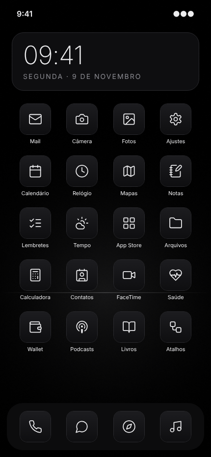

# Noir — tema escuro e minimalista para iOS

Ícones em traço fino sobre fundo grafite, papéis de parede quase pretos e widgets discretos.
Funciona **sem jailbreak** (app Atalhos + Scriptable). Para quem tem jailbreak, também há um pacote **SnowBoard**.



## O que vem no tema

| Pasta | Conteúdo |
|---|---|
| `dist/icons/` | 46 ícones em 512×512 px (apps da Apple e apps populares) |
| `dist/wallpapers/` | 4 papéis de parede em 1290×2796 px: `void`, `horizon`, `grid`, `orbit` |
| `widgets/` | 2 widgets para o Scriptable: relógio com bateria e agenda |
| `dist/snowboard/` e `dist/*.deb` | Pacote SnowBoard (apenas para jailbreak) |

### Paleta

| Token | Cor | Uso |
|---|---|---|
| background | `#000000` | Fundo dos papéis de parede |
| tile | `#0E0E10` | Fundo dos ícones e widgets |
| tileEdge | `#1C1C1F` | Topo do degradê dos ícones |
| line | `#2A2A2E` | Bordas e divisores |
| text | `#EDEDEF` | Glifos e texto principal |
| muted | `#8A8A90` | Texto secundário |

## Instalação sem jailbreak

### 1. Ajustes do sistema
- **Ajustes › Tela e Brilho › Escuro.**
- iOS 18 ou posterior: na tela inicial, toque e segure num espaço vazio › **Editar › Personalizar › Escuro**. Os ícones da Apple que você não trocar ficam escuros também.
- Opcional: **Ajustes › Acessibilidade › Tela e Tamanho do Texto › Reduzir Transparência** deixa o dock e as pastas mais sólidos.

### 2. Papel de parede
1. Abra um arquivo de `dist/wallpapers/` no iPhone (pelo GitHub, AirDrop ou iCloud Drive) e salve em Fotos.
2. **Ajustes › Imagem de Fundo › Adicionar Nova Imagem de Fundo › Fotos**.
3. `horizon` e `orbit` ficam melhores na tela inicial; `void` e `grid` na tela de bloqueio.

### 3. Ícones (app Atalhos)
Repita para cada app:
1. Salve o ícone de `dist/icons/` em Fotos.
2. Abra **Atalhos › + › Adicionar Ação › Abrir App** e escolha o app.
3. Toque no nome do atalho no topo › **Adicionar à Tela de Início**.
4. Toque no ícone pequeno › **Escolher Foto** e selecione o ícone Noir. Dê o nome do app e toque em **Adicionar**.
5. Mova o app original para a Biblioteca de Apps (toque e segure › Remover App › Remover da Tela de Início).

> No iOS 17 ou anterior, abrir um atalho mostra um aviso rápido no topo da tela. É uma limitação do sistema, não do tema.

### 4. Widgets (app Scriptable)
1. Instale o **Scriptable** (grátis, na App Store).
2. No Scriptable, toque em **+**, cole o conteúdo de `widgets/noir-relogio.js` e dê o nome **Noir Relógio**. Faça o mesmo com `widgets/noir-agenda.js` (**Noir Agenda**).
3. Na tela inicial: toque e segure › **Editar › Adicionar Widget › Scriptable**. Escolha o tamanho (pequeno ou médio para o relógio; médio ou grande para a agenda).
4. Toque no widget › **Script** › escolha o script.
5. Na primeira execução, a agenda pede acesso ao Calendário.

### Layout sugerido
- Uma página só, com o widget de relógio (médio) no topo e no máximo 16 apps.
- Dock com 4 apps: Telefone, Safari, Mensagens e Música.
- Todo o resto na Biblioteca de Apps. Use **Ajustes › Foco** para ter páginas diferentes para trabalho e descanso.

## Instalação com jailbreak (SnowBoard)
1. Instale o **SnowBoard** pelo seu gerenciador de pacotes.
2. Copie `dist/noir_1.0.0_iphoneos-arm.deb` para o aparelho e instale com Sileo ou Zebra (ou use o Filza).
3. **Ajustes › SnowBoard › Temas** › ative **Noir** › Respring.

Os ícones usam o nome do pacote de cada app (`<bundle>-large.png`). Se algum app de terceiros não mudar, confira o identificador dele e corrija em `src/apps.json`.

## Personalizar e gerar de novo
Requisitos: Node.js 18+ e Playwright com Chromium.

```bash
npm install
npm run build
```

- Cores: `src/theme.json`. Para um toque de cor, troque `text` por exemplo para `#C8FF5A`.
- Espessura e tamanho dos glifos: `icon.strokeWidth` e `icon.glyphScale` em `src/theme.json`.
- Apps: adicione entradas em `src/apps.json` com `name`, `bundle` e `icon` (qualquer nome de <https://lucide.dev/icons>).

## Créditos e licença
- Tema: MIT (`LICENSE`).
- Glifos: [Lucide](https://lucide.dev), licença ISC (`LICENSE-lucide`).
- Os ícones de apps de terceiros são símbolos genéricos, não os logotipos das marcas. Nomes de apps pertencem aos seus donos.
